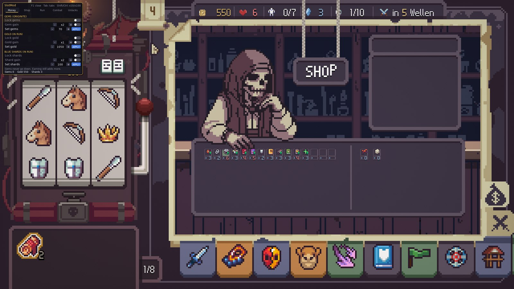
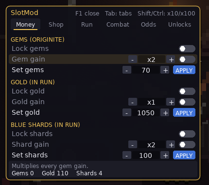
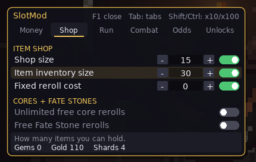
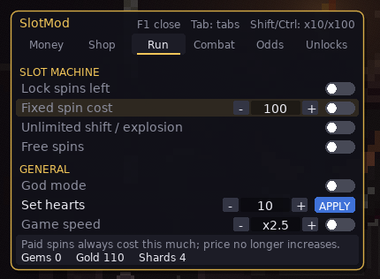
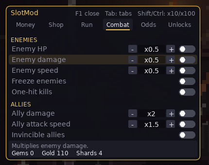
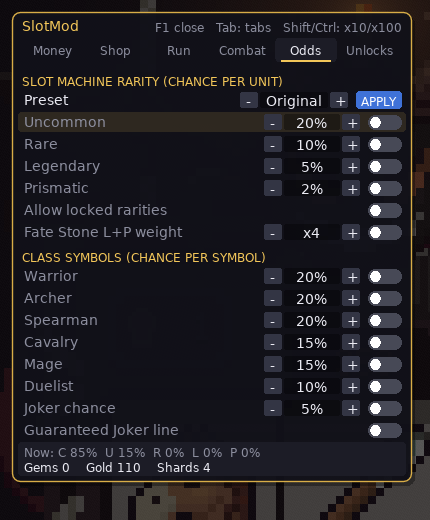
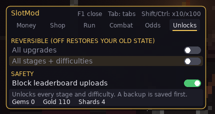
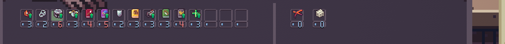

# SlotMod

An in-game mod menu for **Slotbound** (Windows). Every cheat is a switch you can turn on and off at any time, and most have an adjustable value instead of just "unlimited".



- **No game files are changed.** `SlotMod.exe` loads the mod into the running game; close the game and it's gone.
- **Hot reload.** The whole menu is one Lua file (`SlotMod/slotmod.lua`). Save it while the game runs and the changes apply within a second.
- **Leaderboard-safe by default.** Online leaderboard uploads are blocked while the mod is loaded (can be turned off in the Unlocks tab).

> Use it for single-player fun. Don't use it to compete with other players.

## Features

| Money | Shop | Run |
|---|---|---|
|  |  |  |

| Combat | Odds | Unlocks |
|---|---|---|
|  |  |  |

**Money**
- Gems (Originite): lock, gain multiplier, set an exact amount
- Gold (in run): lock, gain multiplier, set an exact amount
- Blue shards (in run): lock, gain multiplier, set an exact amount

**Shop**
- Shop size up to 15 items. Slots, icons and prices shrink to fit the shop:

  
- Item inventory size
- Fixed shop reroll cost (0 = free)
- Unlimited free core rerolls
- Free Fate Stone rerolls *

**Run**
- Lock spins left
- Fixed spin cost (the price no longer goes up after every paid spin)
- Unlimited shift / explosion (slot machine ability)
- Free spins (keeps a free spin credit) *
- God mode (base HP can't drop), set hearts *
- Game speed x0.1 to x10

**Combat**
- Enemy HP, damage and move speed multipliers
- Freeze enemies, one-hit kills
- Ally damage and attack speed multipliers, invincible allies

**Odds** *
- Slot machine rarity: pin the chance of Uncommon / Rare / Legendary / Prismatic units; unpinned rarities share the rest. The help line shows the resulting odds live.
- Presets: Original, Hard, Medium, Easy, Bliss
- Allow locked rarities (otherwise rarities you haven't unlocked stay at 0%)
- Fate Stones: multiply the Legendary + Prismatic weights
- Class symbols: pin the chance of Warrior / Archer / Spearman / Cavalry / Mage / Duelist
- Joker chance (0-5%, the game's cap) and a guaranteed Joker line on the middle row

Features marked * are adapted from [Slotbound OddsMod](https://github.com/TokioKaze/-Slotbound-OddsMod-) by TokioKaze (see [Credits](#credits)).

**Unlocks**
- All upgrades, all stages + difficulties. Turning them on saves a backup first; turning them off restores your previous state.
- Block leaderboard uploads

## Controls

| Action | Keyboard | Mouse |
|---|---|---|
| Open / close menu | **F1** or **Insert** | |
| Switch tab | Tab / Shift+Tab, PageUp / PageDown | click a tab |
| Select row | Up / Down | hover |
| Toggle / apply | Enter or Space | click the switch / APPLY |
| Change value | Left / Right (Shift = x10, Ctrl = x100) | `-` / `+` or mouse wheel |
| Exact value | type digits, then Enter | |
| Move window | | drag the title bar |

Your switches and values are saved in `SlotMod/slotmod_settings.txt` and come back the next time.

## Building it yourself

There is no prebuilt download: you build the two small binaries from source. It takes about a minute.

**You need**
- Windows 10/11, 64-bit
- [Visual Studio 2022 Community](https://visualstudio.microsoft.com/vs/community/) (free) with the workload **"Desktop development with C++"**
- Slotbound installed

**Steps**
1. Download this repository (green **Code** button > **Download ZIP**, or `git clone`).
2. Double-click `slotmod_src\build.bat`.
   It finds Visual Studio automatically and writes `SlotMod.exe` and `slotmod.dll` into the `SlotMod` folder.
   If it says `cl.exe not found`, open **"x64 Native Tools Command Prompt for VS 2022"** from the Start menu, `cd` into `slotmod_src` and run `build.bat` there.
3. Copy the whole `SlotMod` folder into the Slotbound game folder, so it looks like this:
   ```
   Slotbound\
     Slotbound.exe
     Slotbound.dat
     ...
     SlotMod\
       SlotMod.exe
       slotmod.dll
       slotmod.lua
   ```
4. Start **`SlotMod\SlotMod.exe`**. It starts the game through Steam (or attaches if the game is already running), waits for the main menu and loads the mod. Press **F1** in game.

**Custom launcher (optional).** If you start the game some other way, create `SlotMod\SlotMod.ini`:
```ini
[SlotMod]
launch=..\Slotbound.exe
```
`launch=` can be a path relative to the `SlotMod` folder, an absolute path, or a URL. You can also just start the game yourself and run `SlotMod.exe` afterwards.

## How it works

- `slotmod_src/injector.c` → `SlotMod.exe`: starts the game if needed, waits until the window is up, then loads `slotmod.dll` into the game process.
- `slotmod_src/slotmod.c` → `slotmod.dll`: finds the game's Lua runtime and redirects two of the engine's calls (only in memory) so it can run `slotmod.lua` on the game's main thread. It also reloads the file whenever it changes.
- `SlotMod/slotmod.lua`: the menu and all features. It wraps the game's draw, update and input callbacks to draw the menu and apply the switches every frame.

## Troubleshooting

- **Nothing happens on F1**: check `SlotMod\slotmod_log.txt`. It should say `slotmod.lua loaded`.
- **"Could not start the game"**: start Slotbound yourself, then run `SlotMod.exe`, or set `launch=` in `SlotMod.ini`.
- **A game update broke something**: the log names the failing part; open an issue with the log attached.
- **Undo unlocks**: switch "All upgrades" / "All stages + difficulties" off again. The backup is in `SlotMod\slotmod_unlock_backup.txt`.

## Credits

- **Odds features** (slot rarity chances and presets, Fate Stone weights, class-symbol and Joker chances, guaranteed Joker line) and the free spins / set hearts / free Fate Stone reroll utilities are adapted from **[Slotbound OddsMod](https://github.com/TokioKaze/-Slotbound-OddsMod-) by [TokioKaze](https://github.com/TokioKaze)**, licensed under the **MIT License** (Copyright (c) 2026 TokioKaze).
  OddsMod patches the game's data file instead; SlotMod applies the same ideas at runtime through its menu. The full license text is in [THIRD_PARTY_NOTICES.md](THIRD_PARTY_NOTICES.md).
  If you only want odds tweaks with a ready-made installer, use OddsMod. Don't run both at the same time: SlotMod notices if OddsMod already hooked the odds and leaves them alone.

## Disclaimer

Not affiliated with or endorsed by the developers of Slotbound. Back up your save before using unlocks. Use at your own risk.
